<div align="center">
  
</div>


<!-- EDIT: the about text and stack below are placeholders; replace with your own. -->

```text
C:\> TYPE ABOUT.TXT

  > building     TypeScript, React / Next.js, and small tools that do one job well
  > tinkering    microcontrollers (Arduino, ESP, STM32) and anything with a serial port
  > believes     readonly types, small diffs, and leaving systems better documented than found
```

<p align="center">
  
</p>


<p align="center">
  <picture>
    <source media="(prefers-color-scheme: dark)" srcset="https://raw.githubusercontent.com/THEtheChad/THEtheChad/output/snake-dark.svg" />
    <source media="(prefers-color-scheme: light)" srcset="https://raw.githubusercontent.com/THEtheChad/THEtheChad/output/snake-light.svg" />
    
  </picture>
</p>

<!--
  Optional stats cards. The public github-readme-stats instance is often rate-limited,
  so deploy your own copy (https://github.com/anuraghazra/github-readme-stats#deploy-on-your-own)
  and swap in your URL before uncommenting.

<p align="center">
  
  
</p>
-->

<p align="center">
  
  <br />
  <sub><code>BEST VIEWED AT 800×600 · 256 COLORS</code></sub>
</p>
