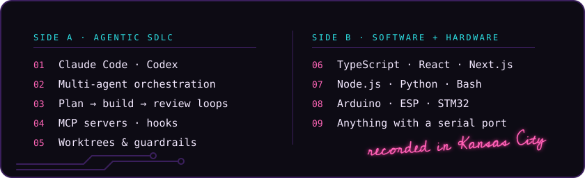

  

<picture>
  <source media="(prefers-color-scheme: light)" srcset="assets/h-about-light.svg" />
  
</picture>

<!-- EDIT: the about text and track list are placeholders; replace with your own (tracks live in tools/build_assets.py). -->

These days I'm all-in on **AI and the agentic SDLC**: orchestrating coding agents like Claude Code and Codex
across the whole lifecycle, from planning and implementation to review, with the worktrees, hooks, and guardrails that keep them honest.
Underneath that it's still **TypeScript, React, and Next.js**, and away from the browser I tinker with
**microcontrollers** (Arduino, ESP, STM32) and anything with a serial port.

<picture>
  <source media="(prefers-color-scheme: light)" srcset="assets/h-stack-light.svg" />
  
</picture>

<picture>
  <source media="(prefers-color-scheme: light)" srcset="assets/h-playing-light.svg" />
  
</picture>

https://github.com/user-attachments/assets/01024920-9cb2-44c6-b833-9130d0e9154f

<code>SIDE C · "COASTAL CHIMES" · SOUND ON ♪</code>

<picture>
  <source media="(prefers-color-scheme: light)" srcset="assets/h-lately-light.svg" />
  
</picture>

  <picture>
    <source media="(prefers-color-scheme: dark)" srcset="https://raw.githubusercontent.com/THEtheChad/THEtheChad/output/snake-dark.svg" />
    <source media="(prefers-color-scheme: light)" srcset="https://raw.githubusercontent.com/THEtheChad/THEtheChad/output/snake-light.svg" />
    
  </picture>

<!--
  Optional stats cards. The public github-readme-stats instance is often rate-limited,
  so deploy your own copy (https://github.com/anuraghazra/github-readme-stats#deploy-on-your-own)
  and swap in your URL before uncommenting.

  
  

-->

  
   
  <code>BEST VIEWED AFTER MIDNIGHT · KANSAS CITY, MO</code>

